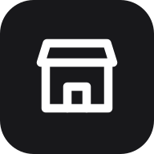
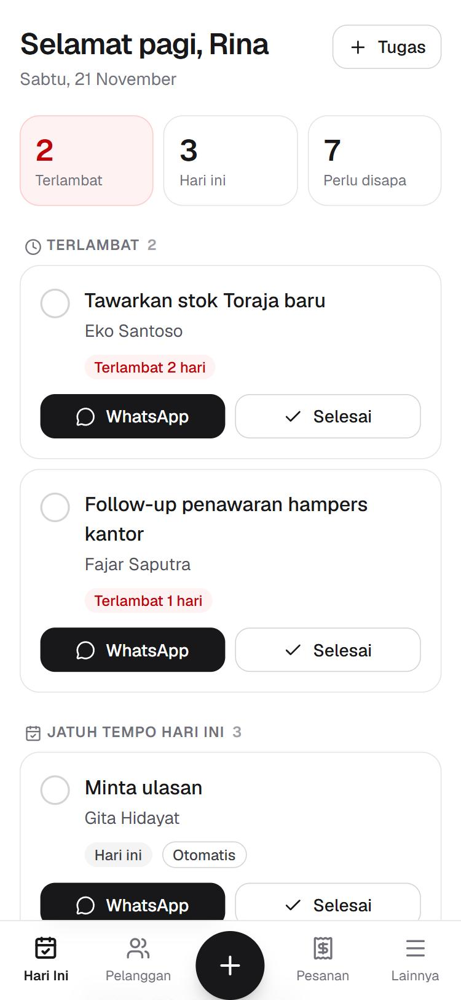
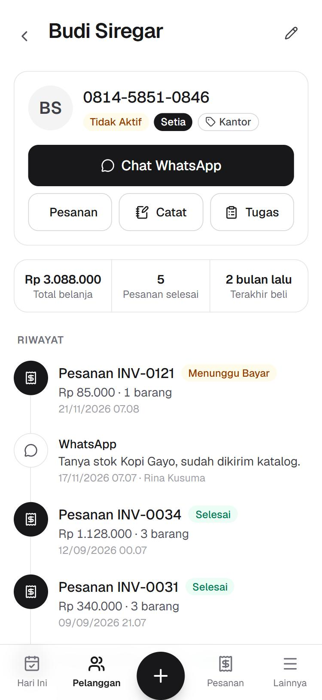
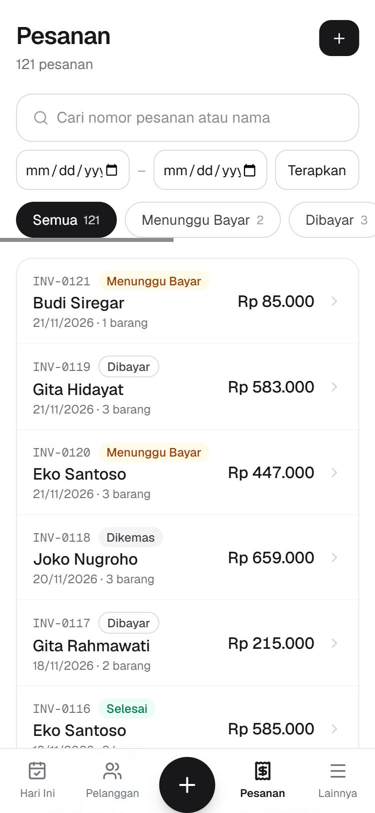
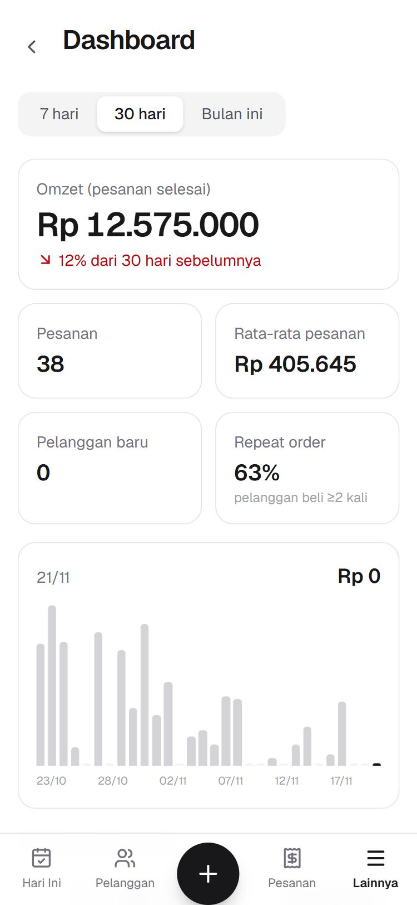
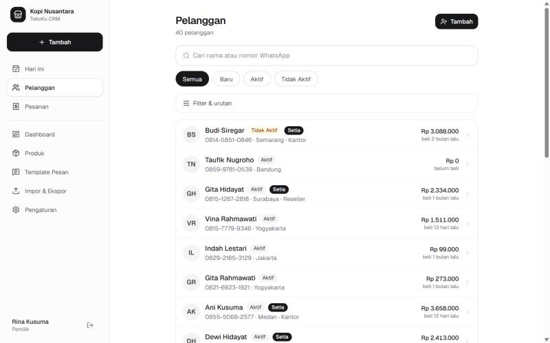
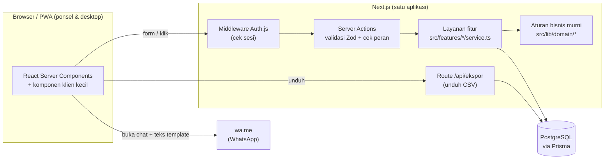
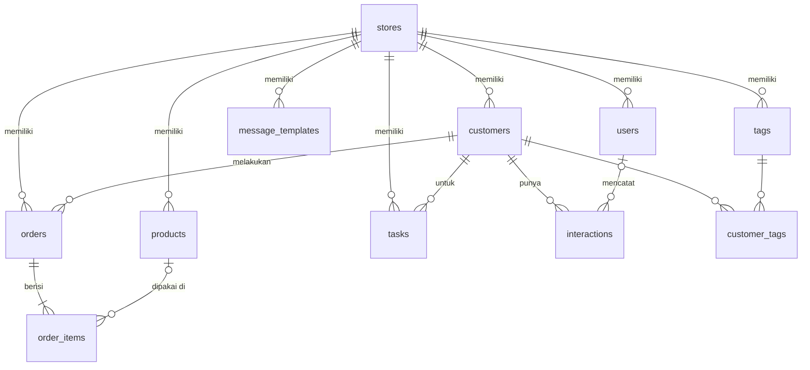

<div align="center">



# TokoKu CRM

**CRM sederhana untuk UMKM dan toko online Indonesia.**
Catat pelanggan, kelola pesanan, dan follow-up lewat WhatsApp, cukup dari HP.


</div>

---

## Daftar isi

- [Masalah yang diselesaikan](#masalah-yang-diselesaikan)
- [Tangkapan layar](#tangkapan-layar)
- [Fitur](#fitur)
- [Coba sekarang (akun demo)](#coba-sekarang-akun-demo)
- [Menjalankan di komputer sendiri](#menjalankan-di-komputer-sendiri)
- [Deploy gratis (Vercel + Neon)](#deploy-gratis-vercel--neon)
- [Arsitektur](#arsitektur)
- [Struktur folder](#struktur-folder)
- [Rancangan basis data](#rancangan-basis-data)
- [Aturan bisnis](#aturan-bisnis)
- [Keputusan desain UI/UX](#keputusan-desain-uiux)
- [Pengujian](#pengujian)
- [Keamanan & privasi](#keamanan--privasi)
- [Peta jalan](#peta-jalan)
- [Lisensi](#lisensi)

---

## Masalah yang diselesaikan

Banyak pelaku UMKM mengelola pelanggan lewat buku catatan, chat WhatsApp, atau spreadsheet. Akibatnya:

- data pelanggan tersebar dan mudah hilang,
- riwayat pembelian tidak tercatat rapi,
- pelanggan lama tidak pernah disapa lagi (tidak ada follow-up),
- pemilik tidak tahu siapa pelanggan terbaik dan produk apa yang paling laku.

CRM yang ada umumnya terlalu rumit dan mahal untuk skala UMKM. **TokoKu** dibuat sesederhana mungkin: kolom wajib hanya nama dan nomor WhatsApp, semua aksi utama maksimal 3 ketukan, dan setiap layar punya satu tombol utama yang jelas.

## Tangkapan layar

| Hari Ini | Detail pelanggan | Pesanan | Dashboard |
| :---: | :---: | :---: | :---: |
|  |  |  |  |

<p align="center"><br/><sub>Tampilan desktop dengan sidebar</sub></p>

## Fitur

| Modul | Yang bisa dilakukan |
| --- | --- |
| **Hari Ini** | Daftar follow-up yang terlambat dan jatuh tempo, pelanggan yang berulang tahun, dan pelanggan yang lama tidak belanja. Setiap kartu punya tombol WhatsApp dan tombol "Selesai" yang bisa diberi catatan singkat. |
| **Pelanggan** | Tambah/ubah/hapus (soft delete), deteksi nomor ganda langsung saat mengetik, tag (VIP, Reseller, …), cari nama/nomor, filter status/tag/kota/sumber, urutkan berdasarkan belanja terbesar. |
| **Status otomatis** | *Baru*, *Aktif*, *Tidak Aktif* (ambang hari bisa diatur), dan label *Setia* (≥ 3 pesanan selesai). |
| **Riwayat (timeline)** | Pesanan dan interaksi (chat, telepon, tatap muka, keluhan, catatan) dalam satu linimasa per pelanggan. |
| **Pesanan** | Pilih produk atau ketik manual, jumlah, diskon, ongkir, metode bayar. Status: Menunggu Bayar → Dibayar → Dikemas → Dikirim (isi resi) → Selesai / Batal. Ada tombol "Pesan ulang" dan filter status/tanggal. |
| **Follow-up otomatis** | Saat pesanan selesai, sistem membuat tugas **"Minta ulasan"** untuk 3 hari kemudian. |
| **WhatsApp** | Tombol `wa.me` dengan template berisi variabel `{nama}`, `{produk}`, `{total}`, `{resi}`. Muncul peringatan jika data belum tersedia (misalnya resi kosong). Setiap pesan tercatat otomatis di riwayat. |
| **Template pesan** | Enam template bawaan (Terima kasih, Konfirmasi pesanan, Info resi, Promo, Pengingat, Ulang tahun), editor dengan chip variabel, dan pratinjau langsung. |
| **Produk** | Katalog sederhana: harga, kategori, SKU/stok opsional, siklus beli ulang. |
| **Dashboard** | Omzet dengan perbandingan periode sebelumnya, jumlah pesanan, rata-rata nilai pesanan, pelanggan baru, % repeat order, grafik omzet harian, pelanggan teratas, produk terlaris, dan sumber pelanggan. |
| **Impor & ekspor CSV** | Wizard 3 langkah: unggah, cocokkan kolom (ditebak otomatis), lalu periksa. Nomor ganda dan baris tidak valid ditandai dengan alasannya. Mendukung CSV dari Excel Indonesia (pemisah `;`). Pelanggan dan pesanan bisa diekspor ke CSV. |
| **Tim & peran** | Pemilik, Admin, Staf sesuai matriks hak akses. Diperiksa di server, bukan cuma disembunyikan di UI. |
| **PWA** | Bisa dipasang di layar utama HP seperti aplikasi. |

## Coba sekarang (akun demo)

Setelah menjalankan seed (lihat di bawah), masuk dengan:

| Peran | Email | Kata sandi |
| --- | --- | --- |
| Pemilik | `demo@tokoku.id` | `demo12345` |
| Staf (akses terbatas) | `staf@tokoku.id` | `demo12345` |

Data demo berisi toko kopi fiktif "Kopi Nusantara": 40 pelanggan, 12 produk, 120 pesanan selama 90 hari, interaksi, dan beberapa tugas yang terlambat. Masuk sebagai Staf untuk melihat bagaimana menu Dashboard, Impor/Ekspor, dan Pengaturan disembunyikan sekaligus ditolak di server.

## Menjalankan di komputer sendiri

**Prasyarat:** Node.js 20+ dan Docker (untuk PostgreSQL). Bisa juga memakai PostgreSQL yang sudah terpasang atau gratisan dari Neon/Supabase.

```bash
git clone <url-repo-ini> tokoku-crm
cd tokoku-crm
npm install

# 1. Siapkan variabel lingkungan
cp .env.example .env
#    lalu isi AUTH_SECRET dengan string acak, misalnya hasil:
npx auth secret

# 2. Nyalakan PostgreSQL (port 5433, juga membuat database tokoku_test)
docker compose up -d

# 3. Buat tabel & isi data demo
npx prisma migrate dev
npm run db:seed

# 4. Jalankan
npm run dev
```

Buka <http://localhost:3000> lalu masuk dengan akun demo.

### Perintah yang berguna

| Perintah | Fungsi |
| --- | --- |
| `npm run dev` | Server pengembangan |
| `npm test` | Seluruh tes (unit + integrasi ke database tes) |
| `npm run db:test:prepare` | Terapkan migrasi ke database tes |
| `npm run db:seed` | Isi ulang data demo (aman diulang) |
| `npx prisma studio` | Lihat isi database lewat browser |
| `npm run lint` | Pemeriksaan ESLint |

## Deploy gratis (Vercel + Neon)

1. Buat database gratis di [Neon](https://neon.tech) dan salin *connection string*-nya.
2. Impor repo ini di [Vercel](https://vercel.com/new).
3. Isi Environment Variables: `DATABASE_URL` (dari Neon) dan `AUTH_SECRET` (string acak).
4. Ubah **Build Command** menjadi `npx prisma migrate deploy && next build`.
5. Deploy. Untuk mengisi data demo di server: `DATABASE_URL="<url neon>" npm run db:seed` dari komputer Anda.

## Arsitektur



**Mengapa begini?**

- **Satu proyek Next.js full-stack.** Frontend dan backend ada di satu repo dan satu deploy. Biaya hosting nol di Vercel + Neon, sesuai batasan "biaya infrastruktur rendah" di dokumen kebutuhan.
- **Server Actions, bukan REST API terpisah.** Kliennya hanya satu (web), jadi Server Actions mengurangi kode perantara. Setiap action selalu: ambil sesi → cek peran → validasi Zod → panggil layanan. REST API publik akan ditambahkan saat ada klien kedua (aplikasi native / integrasi).
- **Tiga lapisan.** `actions.ts` (HTTP & sesi) → `service.ts` (database, selalu menerima `storeId`) → `lib/domain` (fungsi murni tanpa database). Aturan bisnis bisa diuji tanpa server, dan layanan bisa diuji tanpa login.
- **Tanpa cron.** Tugas "Minta ulasan" dibuat saat status pesanan diubah. Ulang tahun dan pelanggan tidak aktif dihitung saat halaman Hari Ini dibuka. Hasilnya sama, tapi tanpa biaya penjadwal.

## Struktur folder

```
src/
├── app/
│   ├── (auth)/            # masuk, daftar
│   ├── (app)/             # halaman setelah login (hari-ini, pelanggan, pesanan, …)
│   └── api/               # auth & ekspor CSV
├── components/
│   ├── ui/                # Button, Field, Sheet, Badge, … (sistem desain monokrom)
│   └── shell/             # bilah bawah ponsel, sidebar desktop, tombol (+)
├── features/              # satu folder per modul
│   ├── customers/         #   service.ts · actions.ts · komponen · *.test.ts
│   ├── orders/
│   ├── tasks/  interactions/  templates/  products/
│   ├── dashboard/  csv/  settings/  auth/
├── lib/
│   ├── domain/            # aturan bisnis murni (nomor, total, status, template, format)
│   ├── permissions.ts     # matriks hak akses
│   └── db.ts  session.ts  store.ts  utils.ts
prisma/
├── schema.prisma  migrations/  seed.ts
docs/superpowers/          # dokumen desain & rencana implementasi
```

## Rancangan basis data



Semua tabel data memiliki `store_id` (multi-tenant). Indeks utama: `customers(store_id, phone)` unik, `customers(store_id, last_order_at)`, `orders(store_id, order_date)`, `orders(customer_id)`, `tasks(store_id, due_date, is_done)`.

## Aturan bisnis

Semua aturan ada di `src/lib/domain/` dan dilindungi tes unit.

| # | Aturan | Implementasi |
| --- | --- | --- |
| 1 | Nomor dinormalisasi: `0812…`, `+62 812…`, `812…` → `62812…` | `normalizePhone()` |
| 2 | Satu nomor hanya untuk satu pelanggan per toko | indeks unik + `DuplicatePhoneError` |
| 3 & 6 | Total belanja hanya dari pesanan **Selesai**. Pembatalan otomatis mengurangi | `computeCustomerStats()` selalu menghitung ulang dari semua pesanan, bukan menambah/mengurangi |
| 4 | Tidak Aktif jika tidak ada pesanan selama N hari (bawaan 60, bisa diatur) | `customerStatus()` + `statusWhere()` (versi SQL yang setara, agar filter dan label selalu cocok) |
| 5 | Setia = minimal 3 pesanan selesai | `isLoyal()` |
| 7 | Data dihapus disimpan dulu (soft delete). Menambah nomor yang sama akan memulihkan pelanggan | `softDeleteCustomer()` |
| 8 | Template dengan variabel kosong menampilkan peringatan sebelum dikirim | `renderTemplate()` → `missing[]` |

## Keputusan desain UI/UX

- **Putih + monokrom.** Hitam/abu-abu untuk semua elemen. Warna hanya dipakai untuk arti (merah redup = terlambat/batal, hijau redup = selesai, kuning redup = menunggu/tidak aktif), jadi mata langsung tertuju ke yang penting.
- **Mobile first, satu tangan.** Bilah bawah berisi Hari Ini · Pelanggan · (+) · Pesanan · Lainnya. Tombol (+) di tengah membuka aksi cepat. Semua target sentuh ≥ 44 px.
- **Satu tombol utama per layar.** Contohnya di detail pesanan: tombol besar selalu menunjukkan langkah berikutnya ("Sudah dibayar" → "Mulai dikemas" → "Kirim + resi" → "Pesanan selesai").
- **Input minimal.** Kolom wajib hanya nama dan nomor WhatsApp. Sisanya dilipat di "Detail tambahan". Tombol "Simpan & buat pesanan" menghemat satu langkah.
- **Bahasa sehari-hari.** "Lama tidak belanja", "Sapa lagi", "Tetap kirim", bukan istilah teknis.
- **Rupiah & tanggal Indonesia.** `Rp 1.250.000` dan `dd/mm/yyyy` dengan zona waktu Asia/Jakarta, termasuk batas hari di dashboard.
- **Keadaan kosong yang membantu.** Setiap daftar kosong menjelaskan apa yang harus dilakukan berikutnya.

## Pengujian

```bash
npm test
```

**41 tes** (Vitest) dalam dua lapis:

- **Unit:** normalisasi nomor, total pesanan, statistik & status pelanggan, render template, format Rupiah/tanggal, hak akses peran, analisis impor CSV.
- **Integrasi** (ke database PostgreSQL tes yang terpisah):
  - isolasi data antar toko
  - deteksi nomor ganda lintas format
  - soft delete dan pemulihan
  - penomoran `INV-0001` per toko
  - pesanan Selesai menambah total dan membuat tugas ulasan, Batal menguranginya
  - pesan ulang
  - isi halaman Hari Ini
  - ringkasan dashboard

Setiap tes membuat toko sendiri, sehingga tes bisa diulang tanpa mengosongkan database.

## Keamanan & privasi

- Kata sandi di-hash dengan **bcrypt**. Sesi JWT ditandatangani `AUTH_SECRET`.
- **Isolasi tenant.** Setiap query menyertakan `storeId` dari sesi, tidak pernah dari input pengguna. Diuji di `service.test.ts`.
- **Hak akses dicek di server** (`assertCan`) untuk hapus pelanggan, laporan, ekspor, dan pengaturan.
- Validasi semua input dengan **Zod**. React meng-escape output (perlindungan XSS). Server Actions Next.js sudah membawa perlindungan CSRF.
- Data impor dianalisis ulang di server, bukan mempercayai hasil pratinjau dari klien.
- Mendukung hak pengguna UU PDP: ekspor data lengkap dan hapus pelanggan.

## Peta jalan

- [ ] Reset kata sandi lewat email
- [ ] Notifikasi email/browser untuk follow-up
- [ ] Segmen siap pakai & kustom, lalu kampanye ke segmen
- [ ] Pengingat beli ulang berdasarkan siklus produk (`repurchase_days` sudah tersedia)
- [ ] Invoice PDF
- [ ] Integrasi WhatsApp Business API resmi
- [ ] Impor pesanan dari marketplace (file ekspor → API)
- [ ] Pembatasan percobaan masuk (rate limiting)

## Lisensi

[MIT](LICENSE)
